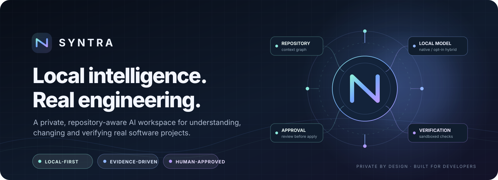
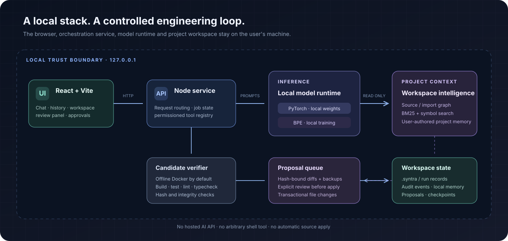

<div align="center">
  

  <p><strong>A local-first AI engineering workspace built around SYNTRA's own PyTorch model.</strong></p>

  <p>
    <a href="https://github.com/EldarJamiyev/SYNTRA"></a>
    
    
    <a href="LICENSE"></a>
  </p>

  <p>
    <a href="#what-is-syntra">Overview</a> &nbsp;·&nbsp;
    <a href="#current-project-status">Project status</a> &nbsp;·&nbsp;
    <a href="#capabilities">Capabilities</a> &nbsp;·&nbsp;
    <a href="#architecture">Architecture</a> &nbsp;·&nbsp;
    <a href="#get-started">Get started</a> &nbsp;·&nbsp;
    <a href="#documentation">Documentation</a>
  </p>
</div>

---

## What is SYNTRA?

SYNTRA is a local AI workspace for conversation, repository understanding, bounded coding-agent workflows, and practical network diagnostics. Its application uses a native Python/PyTorch Transformer trained from local data. The model, tokenizer, checkpoints, source retrieval, and inference are managed within the SYNTRA runtime.

The project is built around a few engineering principles:

- **Local inference:** chat, code generation, self-review, and semantic embeddings use SYNTRA's own checkpoint. There is no Ollama, hosted model API, Hugging Face model download, or external inference-provider fallback.
- **Real repository context:** the agent searches and reads the selected workspace before proposing changes. Retrieved source is treated as untrusted project content, not as instructions.
- **Reviewable changes:** code edits are prepared as candidate patches, checked against the request, and staged as proposals. A generated patch is not automatically treated as correct.
- **Bounded operations:** local tools have explicit inputs and limits. Sensitive operations require approval; the chat does not expose a general-purpose shell.
- **Evidence over claims:** runtime status, test outcomes, checkpoint identity, and benchmark results are reported from actual local operations.

SYNTRA is an actively developed engineering and model-training project. It is not a pretrained frontier coding model, a finished autonomous software engineer, or a production-certified deployment.

## Current project status

The current `main` baseline includes the chat application, native model training and inference, local network diagnostics, repository-aware investigation, patch proposal and review workflows, bounded multi-step orchestration, local semantic retrieval, and a fixture-based coding-agent benchmark.

The native model starts with randomly initialized weights. The Windows launcher trains a starter checkpoint from the checked-out repository; this makes the application runnable with its own model, but does not establish strong general-purpose coding ability. Model quality still depends on training data and must be measured through repeatable task evaluations.

**Current development focus:** improving the usefulness of SYNTRA's native model through better local corpus curation, repeatable task-level evaluations, and measured coding-agent outcomes. Repository curriculum generation and structured instruction training are now part of `main`; generated data still requires review and evaluation before it can support claims of improved capability.

## Capabilities

### Chat-first local workspace

- A focused React and TypeScript chat interface with streamed local model responses.
- Multiple named conversations with local history and workspace selection.
- A local model status view that reports the actual checkpoint and available training metadata.
- Markdown, code, and structured response rendering.

Conversation history and the selected workspace path are stored locally in the browser on that device. They are not a cloud-synchronized account history.

### Local network diagnostics

SYNTRA can run bounded diagnostics from the machine hosting the application:

| Request | Example |
| --- | --- |
| ICMP reachability | `ping example.com` |
| DNS resolution | `DNS lookup for example.com` |
| One TCP port check | `check port 443 on example.com` |

Ping is limited to a small packet count and a TCP check targets one host and one port. These commands execute real local checks; they are not simulated network telemetry. Network diagnostics do not require a trained language-model checkpoint.

### Repository-aware coding workflow

For a coding request, SYNTRA can:

1. Inspect the selected project and gather bounded source context.
2. Search files and symbols, read relevant source ranges, and use the local import/symbol information available for the project.
3. Build a bounded implementation plan for larger tasks.
4. Generate structured candidate patches against inspected source.
5. Run a separate review pass against the request and proposed changes.
6. Verify the candidate with project checks that SYNTRA can identify and safely run.
7. Stage a reviewable proposal with diffs, source fingerprints, backups, and local run history.

The agent can perform bounded, iterative read-only repository investigation and persist verified intermediate candidate state so an interrupted multi-step task can be recovered. It does not have unrestricted permission to modify arbitrary workspace files or execute arbitrary shell commands.

**Important review boundary:** patch review uses the same native checkpoint as generation. It is an additional reasoning pass, not an independent model, external auditor, or guarantee of correctness.

### Repository context and memory

- Full-text and symbol-oriented retrieval over the selected workspace.
- A bounded static import/symbol graph for supported source patterns; this is not a complete language-server or cross-language data-flow analysis.
- Semantic source retrieval and project-memory embeddings produced by SYNTRA's own trained checkpoint.
- Deterministic lexical retrieval remains available for supported fallback paths. Semantic quality depends on the model checkpoint and training corpus.
- Project memory is based on explicitly saved user-authored notes; chat history is not embedded as project memory.

### Agent skill library

The repository includes **66 skill folders** under `.agents/skills/`, including upstream engineering playbooks and SYNTRA-specific guidance for local-model boundaries, workspace safety, network evidence, and chat UI consistency.

- `skills-lock.json` records pinned upstream source revisions and skill-folder hashes.
- Relevant upstream license notices are retained under `.agents/skills/_licenses/`.
- Skills are instruction assets. They do not install runtime dependencies, add tools, enable external model providers, or grant additional execution permissions.
- Technology-specific skills are conditional guidance; their presence does not mean that the corresponding framework or service is installed or used by SYNTRA.

## Architecture

SYNTRA runs as a local application with three cooperating parts:

<p align="center">
  
</p>

| Component | Responsibility |
| --- | --- |
| React + Vite + TypeScript | Chat interface, local sessions, workspace controls, and training/status presentation |
| Node.js local service | Loopback API, workspace access, diagnostic tools, agent orchestration, proposals, and audit records |
| Python + PyTorch (`syntra_ai/`) | Native Transformer training, checkpoint loading, inference, tokenization, embeddings, and model status |
| Standalone `brain/` package | Native Transformer training and generation tools with a checkpoint format supported by the local runtime |

The local services use loopback endpoints: the web interface is served on port `3000`, the workspace API on `3001`, and the native AI service on `3002`. They are intended for local use, not direct public-internet exposure.

## Native model and training

SYNTRA does not download pretrained model weights. It initializes its own decoder-only Transformer and trains it on approved local source data. The native model implementation includes RMSNorm, rotary position embeddings, SwiGLU feed-forward layers, a corpus-trained byte-BPE tokenizer, and cached incremental attention for generation.

The same native checkpoint family supports chat generation, patch generation, patch review, token counting, and dense embeddings. This keeps the application self-contained, but it also means model weaknesses can affect all of those functions.

### First-run behavior

On Windows, `Start-SYNTRA.bat`:

1. Checks for Node.js 20 or newer and Python 3.12 or newer.
2. Installs the web dependencies from the npm lockfile when needed.
3. Creates or validates SYNTRA's isolated, hash-locked Python environment with CPU-only PyTorch.
4. Trains a starter model from the checked-out repository if no valid checkpoint exists. The current launcher target is 1,000 training steps with a 1,024-token context; a smaller context is used only when the source corpus is too small for the larger split.
5. Validates the checkpoint, starts the local services, and opens the chat interface.

The first launch therefore performs real local training and may take substantially longer than later launches. No pretrained model weights are downloaded. Dependency installation may need access to npm and Python package indexes.

### Training and model commands

Run these commands from the repository root:

```powershell
# Show the actual local checkpoint and training status
npm run ai:cli -- status

# Inspect a repository corpus without starting training
npm run ai:cli -- inspect-data --root "C:\Projects\SYNTRA"

# Train or continue the native application model from an approved source root
npm run ai:cli -- train --root "C:\Projects\SYNTRA" --seq-len 1024 --steps 1000

# Validate a structured instruction dataset before fine-tuning
npm run ai:cli -- audit-instructions --dataset "D:\Datasets\instructions.jsonl" --seq-len 1024

# Fine-tune the existing native checkpoint on an audited prompt/completion JSONL dataset
npm run ai:cli -- finetune --dataset "D:\Datasets\instructions.jsonl" --steps 1000

# Generate repository-grounded instruction examples from the project and approved roots
npm run ai:curriculum -- --max-examples 240
```

External training data must be in an explicitly approved absolute directory. In PowerShell, configure the approved root before using it:

```powershell
$env:SYNTRA_ALLOWED_CORPUS_ROOTS = "D:\Datasets"
npm run ai:cli -- inspect-data --root "D:\Datasets\MySource"
```

The corpus loader applies size and file limits and excludes common generated, binary, and likely-secret paths. These checks are defensive heuristics, not a guarantee that every secret can be found. Review training data yourself and do not include credentials, private keys, customer information, or data you are not authorized to use.

Training loss measures next-token prediction on the selected corpus. It does not establish that generated code is correct, that instruction following is reliable, or that the model generalizes to unfamiliar repositories.

### Repository curriculum and instruction training

SYNTRA includes a local curriculum pipeline that turns approved repository source into structured prompt/completion examples. It uses Python AST extraction for Python modules and bounded declaration-aware extraction for supported source languages. The pipeline:

- Scans the project and explicitly approved local corpus roots.
- Extracts Python module structure with the standard-library AST and bounded declaration-aware chunks for other supported source files.
- Generates JSONL examples for module and symbol comprehension, symbol implementation, and narrowly supported source-anchored repair tasks.
- Emits a repair example only when the relevant source pattern and exact transformation can be verified; unsupported cases are skipped.
- Groups related examples when creating train/validation splits to reduce source-module and prompt leakage.
- Masks prompt tokens from supervised loss while training on response tokens and EOS.
- Preserves the existing raw-text training path.

Generate the curriculum from the project and every configured approved root with:

```powershell
npm run ai:curriculum -- --max-examples 240
```

The default output is `data/curricula/workspace-instructions.jsonl`. Use `--root` to scan one approved workspace instead of the project-plus-configured-roots set, and `--output` to choose a JSONL filename inside the project or active workspace. Secondary approved roots receive namespaced source paths; repair patches are emitted only for the active workspace because their paths must resolve against the workspace the coding agent can edit. Currently supported repair examples are intentionally narrow: source-verified Python comparisons against `None`.

Curriculum synthesis and structured instruction training are available in `main`. Generation produces source-grounded examples, not proof of semantic quality or improved coding performance. Review the resulting dataset, run the instruction audit, train a local checkpoint, and compare repeatable task-level benchmark results before concluding that training improved the model.

### Phase 4 local checkpoint optimization and evaluation

The Milestone 4 workflow runs the standalone PyTorch brain trainer against an approved local source corpus, synthesizes the AST-grounded instruction curriculum, audits that JSONL against the checkpoint's actual tokenizer, and fine-tunes response/EOS targets using SYNTRA's existing masked SFT path.

Run from the repository root after installing the documented local dependencies:

```powershell
# Run local source pretraining -> instruction curriculum SFT -> checkpoint benchmarks
npm run brain:milestone4 -- --device auto

# Select an explicit supported local accelerator
npm run brain:milestone4 -- --device cpu
npm run brain:milestone4 -- --device cuda
npm run brain:milestone4 -- --device mps

# Use an existing checkpoint for SFT only
npm run brain:milestone4 -- --skip-pretraining

# Benchmark an existing checkpoint without running either training stage
npm run brain:milestone4 -- --skip-pretraining --skip-sft

# Train without launching model benchmarks
npm run brain:milestone4 -- --skip-benchmark
```

The checked-in profile is `configs/training/phase4_milestone4.json`. It starts with a conservative local configuration (4 layers, 4 heads, width 128, context 512, batch size 2), a 100-step warmup, cosine decay from `3e-4` to `1e-5`, and a 1.0 gradient-norm clipping threshold. The number of additional pretraining steps defaults to 5,000; SFT defaults to 1,000 steps at `1e-4`. These are initial experiment settings, not claims of optimal hyperparameters. Before materializing training tensors, the trainer estimates the device working set and rejects configurations exceeding its 70% available-memory safety budget where the platform exposes a reliable measurement; the estimate is saved in checkpoint metadata. CPU and MPS use the host's available-memory estimate, while CUDA uses free VRAM. This is a conservative guardrail rather than a precise profiler or an OOM guarantee. Tune the profile from actual hardware memory/throughput and task results rather than assuming CPU, CUDA, and Apple MPS have interchangeable performance.

The workflow stages checkpoints under `data/checkpoints/staging/syntra-brain.pt`; it does not overwrite the application's default production checkpoint. Existing staging checkpoints require an explicit exact-resume or backed-up overwrite choice. Each 500-step evaluation uses a checksum-verified, read-only checkpoint snapshot and a separate JSON report. Evaluations run one at a time to limit accelerator contention; the profile defaults the benchmark's inference device to CPU while training selects the requested local device. Docker evaluation requires all five local language images to be pre-provisioned; it never pulls images and uses the benchmark's network-disabled execution. Host evaluation is unsandboxed and requires the explicit `--isolation host --allow-host-execution` acknowledgment.
Managed generated outputs under `data/benchmarks`, `data/curricula`, and `data/checkpoints` are explicitly excluded from source-corpus ingestion in both the AST curriculum scan and raw pretraining scan. The trainer also fingerprints the selected corpus after exclusions, so a changed source/artifact boundary cannot silently resume against a different training set.

Each run stores a manifest, checkpoint snapshots, benchmark JSON, subprocess logs, `summary.md`, and `summary.csv` under `data/benchmarks/phase4-milestone4/<run-id>/`. The summaries correlate actual checkpoint loss values with measured held-out target-completion and regression-prevention rates. Failed benchmarks, missing JSON, checkpoint mismatches, and missing metrics are reported as failed or unavailable—not as zero. No training or benchmark run is started by installing this code; the command above starts real local compute when executed on your machine.


### Phase 5: smoke validation, hardware profiles, and checkpoint promotion

Start with the short end-to-end smoke profile after provisioning the required local Docker images:

```powershell
npm run brain:smoke
```

It runs 50 source-pretraining optimizer steps and 20 masked SFT optimizer steps, then evaluates both immutable checkpoint snapshots through the 13-task offline Docker matrix. It uses CPU by default and writes to separate smoke-only staging/curriculum/report directories; it does not touch the active application checkpoint.

Select a hardware profile for longer experiments:

```powershell
# Low-memory / CPU laptop: physical batch 1 with gradient accumulation
npm run brain:milestone4 -- --config configs/training/local_cpu_fast.json --device cpu

# Dedicated GPU or sufficient unified/system memory; choose CUDA or MPS explicitly when available
npm run brain:milestone4 -- --config configs/training/local_gpu_scale.json --device cuda
npm run brain:milestone4 -- --config configs/training/local_gpu_scale.json --device mps
```

The CPU profile uses a 4-layer, width-64 model with 256-token context, micro-batch 1, and eight-step accumulation. The GPU profile uses an 8-layer/8-head, width-256 model and 1024-token context. These are resource-targeted starting points, not benchmark-proven optima. The trainer reports the estimated working set before allocation and the actual local run's throughput and memory telemetry. CPU reports process peak RSS; CUDA reports allocator peak allocated VRAM; MPS reports the highest sampled driver/allocator memory seen after optimizer steps. Unavailable or inapplicable values remain unavailable, not zero. Token throughput counts supervised target tokens, and step latency measures optimizer-update wall time.

A measured full-suite checkpoint can be promoted only by explicitly selecting its completed evaluation report:

```powershell
# Verify provenance, snapshot SHA-256 and runtime loadability without modifying the active model
npm run brain:promote -- --report "data/benchmarks/<profile>/<run-id>/evaluations/<checkpoint-report>.json" --dry-run

# Promote after reviewing the dry-run output
npm run brain:promote -- --report "data/benchmarks/<profile>/<run-id>/evaluations/<checkpoint-report>.json"

# Restore a previous active checkpoint using the archive ID printed by promotion
npm run brain:promote -- --rollback "20261109T120000Z-1234abcd"
```

Promotion accepts only a complete run of the currently checked-in 13-task raw native-model suite, with valid hidden baselines, a matching SHA-256 in the benchmark report and read-only snapshot manifest, and a checkpoint that the actual SYNTRA runtime can load. It uses the active path selected by `SYNTRA_CHECKPOINT` when set, otherwise SYNTRA's normal default/fallback resolver. Before replacing an active checkpoint it archives the previous full checkpoint and its metadata/inference companion under `data/checkpoints/archive/<timestamp-id>/`; rollback verifies those archive hashes and rebuilds a correctly bound inference companion. Partial task runs, stale suite versions, mismatched artifacts, symlinked paths, and invalid model payloads are rejected.

Promotion is an explicit operator action. Training and benchmarking never auto-promote a model, and no cloud model service or network-enabled benchmark container is introduced.


## Security and execution boundaries

SYNTRA uses explicit local boundaries, but no local coding agent can make arbitrary project code risk-free.

- Application and AI services bind to loopback. The local API validates host/origin information and uses a process-scoped session token.
- Workspace operations are scoped to the selected project and apply canonical path, traversal, symlink, and exclusion checks.
- Model-selected repository investigation is restricted to bounded read-only tools.
- Privileged operations use short-lived, single-use approval capabilities rather than trusting a caller-supplied approval flag.
- Project verification is disabled by default. When enabled with Docker isolation, checks run against a temporary candidate workspace in a restricted container with no network, a read-only container root, dropped capabilities, and resource limits.
- Host verification requires explicit opt-in. It runs repository-defined scripts with the current user's operating-system permissions and is **not sandboxed**.
- The Docker engine and selected image remain part of the trusted computing base. Docker isolation is not a virtual machine boundary.

Do not expose the local services to an untrusted network, do not run untrusted repositories with host verification enabled, and keep SYNTRA and its dependencies patched. See the [operating security model](docs/OPERATING_SECURITY.md) for residual risks and configuration details.

## Benchmarking and evidence

SYNTRA includes a versioned, fixture-based coding-agent benchmark. It exercises the actual local workflow: repository inspection, read-only retrieval, structured patch generation, candidate verification, and proposal staging.

Run it after the native services and a trained checkpoint are available:

```bash
npm run benchmark
```

Useful options:

```bash
npm run benchmark -- --list
npm run benchmark -- --task utility-clamp
npm run benchmark:reports -- history
```

SYNTRA also has a separate **raw native-model** track. It bypasses agent retrieval, planning, review, and orchestration, sending each held-out task directly to the selected native PyTorch checkpoint:

```bash
# List direct-model tasks without loading a model checkpoint
npm run benchmark:model -- --list

# Evaluate one direct-model task or the complete direct-model suite
npm run benchmark:model -- --task python-clamp
npm run benchmark:model
```

The raw-model suite is now version 1.3.0 with 13 held-out fixtures across Python (nine tasks), JavaScript, TypeScript, Go, and Rust. It includes coordinated multi-file patches, ESM event normalization, generic type constraints, cancellation-aware concurrency, safe UTF-8 slicing, and cross-module stream-state validation. Every fixture must demonstrate a failing target baseline and passing independent regression baseline before inference. Hidden tests remain outside the model-visible workspace.

The evaluator selects a pre-existing local image per runtime: `python:3.12-slim`, `node:20-slim` (JavaScript and TypeScript), `golang:1.22-alpine`, and `rust:1.78-slim`. JavaScript syntax/test execution is registered, while the v1.2.0 held-out suite currently includes a TypeScript task rather than a separate JavaScript-only task. It inspects the required images before inference, uses `--pull=never` and `--network none`, and does not install packages inside evaluation containers. TypeScript uses the repository's already-installed compiler mounted read-only. Go proxying and Cargo networking are disabled. Pre-provision all images and the repository's locked npm dependencies before using Docker mode. Host execution requires the explicit, non-sandboxed opt-in `--isolation host --allow-host-execution`.

Prompts expose the fixture's bounded multi-file source context as labeled files. The model must return every required edit in one strict `SYNTRA_AGENT_PATCH_V1` object; duplicate paths, missing sibling edits, extra changed files, or context truncation invalidate the task. Reports record checkpoint identity and saved training history, patch/test outcomes per language, prompt tokens, context-window utilization, explicit context-overflow rejections (including overflow-token counts), generation throughput, and phase timings. Older checkpoints are not backfilled with invented loss history. The `OVERFITTING_LOSS_INTELLIGENCE_DIVERGENCE` signal is evaluated only across tasks whose prompts fit the checkpoint and completed generation; context-rejected tasks remain in the end-to-end score but are excluded from this heuristic. It remains a qualified warning, not causal proof of overfitting.

The existing `npm run benchmark` remains the separate 11-task full-agent benchmark. The 13 raw-model fixtures are narrow, controlled regression cases—not a representative industry benchmark or evidence of broad language competence. Passing SYNTRA unit tests validates the evaluator; only a real run against the actual local checkpoint produces model-performance evidence.

## Get started

### Windows

**Requirements:** Windows PowerShell, Node.js 20 or newer, and Python 3.12 or newer.

```powershell
git clone https://github.com/EldarJamiyev/SYNTRA.git
cd SYNTRA
```

Double-click `Start-SYNTRA.bat`. The launcher prepares the local environments, trains or validates the native checkpoint, starts the services, and opens:

**http://127.0.0.1:3000**

Keep the service windows open while using SYNTRA. On later launches, use the same batch file; a valid checkpoint is reused rather than retrained from scratch.

### Development checks

From the repository root:

```bash
npm ci
npm run lint
npm run build
npm test
npm run test:e2e
```

The full local application also needs the native Python service and the Node workspace service. The Windows launcher is the maintained one-click startup path; consult the architecture and release documentation when running or validating services separately.

## Project structure

```text
SYNTRA/
├── src/                 # React chat interface
├── local/               # Node API, diagnostics, repository agent and workspace tools
├── syntra_ai/           # Native PyTorch model, training, inference and embeddings
├── brain/               # Standalone Transformer training and generation package
├── .agents/skills/      # Curated agent skill library
├── benchmarks/          # Versioned local coding-agent fixtures
├── scripts/             # Setup, startup, CLI bridge, tests and benchmark utilities
├── tests/               # Node and Python tests
├── e2e/                 # Browser end-to-end tests
└── docs/                # Architecture, security, model, benchmark and roadmap notes
```

## Documentation

| Document | Scope |
| --- | --- |
| [Architecture](docs/ARCHITECTURE.md) | Runtime components, request flow, agent orchestration, and recovery |
| [Operating security](docs/OPERATING_SECURITY.md) | Local API boundaries, project-check isolation, and residual risks |
| [Model capabilities](docs/MODEL_CAPABILITIES.md) | Native inference, self-review, benchmark evidence, and limits |
| [Benchmarks](docs/BENCHMARKS.md) | Fixture suite, scoring, report history, and measurement boundaries |
| [Data and hardware](docs/DATA_AND_HARDWARE.md) | Local corpus handling, checkpoint limits, memory estimates, and hardware notes |
| [Product roadmap](docs/ROADMAP.md) | Delivered baseline, remaining phases, and acceptance criteria |
| [Release checklist](docs/RELEASE_CHECKLIST.md) | Repeatable CI, local runtime, security, and release gates |

## License

SYNTRA is released under the [MIT License](LICENSE). Third-party skill and asset notices are documented in [THIRD_PARTY_NOTICES.md](THIRD_PARTY_NOTICES.md).

---

Developed by [Eldar Jamiyev](https://github.com/EldarJamiyev).
