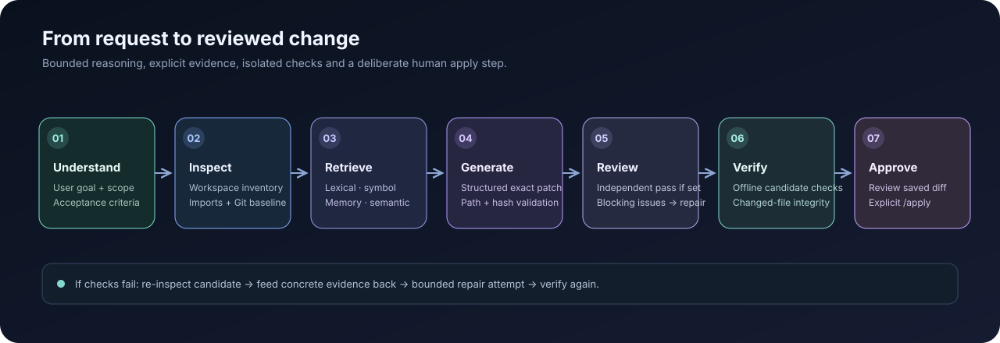
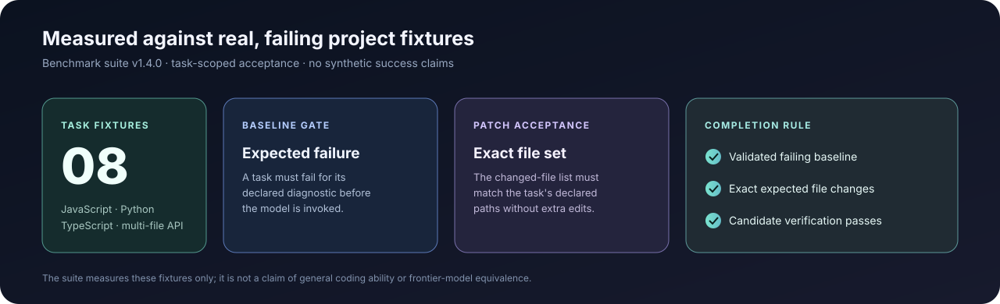

<div align="center">
  

  <p><strong>A local-first AI workspace for conversation, repository understanding, and carefully controlled code changes.</strong></p>

  <p>
    <a href="https://github.com/EldarJamiyev/SYNTRA"></a>
    
    
    <a href="LICENSE"></a>
  </p>

  <p>
    <a href="#-why-syntra">Why SYNTRA</a> &nbsp;·&nbsp;
    <a href="#-capabilities">Capabilities</a> &nbsp;·&nbsp;
    <a href="#-how-the-agent-works">Agent workflow</a> &nbsp;·&nbsp;
    <a href="#-get-started">Get started</a> &nbsp;·&nbsp;
    <a href="#-documentation">Documentation</a>
  </p>
</div>

---

## The idea

SYNTRA brings a focused AI chat experience and a repository-aware coding agent into one application. It is designed to run on your machine, work with a project you select, gather relevant evidence, and make code changes through a reviewable workflow.

**The principle is simple: local control, real tools, observable work, and no pretending.**

It is an evolving engineering project—not a claim of frontier-model intelligence or a finished autonomous software engineer.

## ✦ Why SYNTRA

<table>
  <tr>
    <td width="50%" valign="top">
      <h3>⌂ Local by design</h3>
      Run inference through a locally installed Ollama model. Your workspace agent and application services are designed around loopback access rather than a hosted coding endpoint.
    </td>
    <td width="50%" valign="top">
      <h3>⌘ Understands the repository</h3>
      Inspects project structure, searches source, follows imports and symbols, and retrieves task-specific context before proposing changes.
    </td>
  </tr>
  <tr>
    <td width="50%" valign="top">
      <h3>◇ Changes you can inspect</h3>
      Produces structured patches, reviews proposed edits, checks candidates, and records proposal and run history locally.
    </td>
    <td width="50%" valign="top">
      <h3>⛨ Bounded permissions</h3>
      Separates read-only investigation from operations that change files or run project checks. There is no general-purpose terminal tool in the chat.
    </td>
  </tr>
  <tr>
    <td width="50%" valign="top">
      <h3>◎ More than code generation</h3>
      Supports ordinary conversation and bounded local network diagnostics, including ping, DNS lookup, and a single TCP port check.
    </td>
    <td width="50%" valign="top">
      <h3>▤ Built for continuity</h3>
      Keeps named conversations on the device and preserves workspace run records and recoverable proposals across local-service restarts.
    </td>
  </tr>
</table>

## ✧ Capabilities

### A focused chat workspace

SYNTRA keeps the conversation at the center instead of surrounding it with a large control dashboard.

- Multiple named conversations with search, rename, resume, and delete.
- Local session persistence and migration from the earlier single-thread history.
- Streaming responses from the local Ollama backend.
- Markdown, code blocks, tables, and safe external links.
- A selected project folder that stays associated with the local workspace.

### Practical local diagnostics

Ask naturally, or use the explicit command forms:

| Request | Command |
| --- | --- |
| Ping a host | `ping example.com` or `/ping example.com` |
| Resolve a hostname | `DNS lookup for example.com` or `/dns example.com` |
| Check one TCP port | `check port 443 on example.com` or `/port example.com 443` |
| Check local model availability | `/status` |
| See available commands | `/help` |

These are intentionally bounded local checks. Ping is limited to four packets, and a TCP check targets one host and port. Targets are validated before the local network operation runs.

### Repository-aware coding

For an explicit software-change request, SYNTRA can:

- Route messages through a multi-signal cognitive intent classifier (`coding_task`, `workspace_query`, `conversation`) that extracts target paths and symbols before selecting the execution path.
- Map the selected project and build a local source/import context with declaration-aware excerpts (`makeExcerpt`) and symbol-boundary semantic chunks.
- Search files, read bounded source ranges, and retrieve symbol, documentation, memory, or local semantic-search results.
- Plan larger requests as ordered implementation slices with acceptance criteria.
- Generate structured, exact-anchor patches rather than blindly replacing whole files, while tracking candidate state fingerprints to prevent repetitive repair cycles.
- Run a read-only review pass against the request, candidate changes, and retrieved evidence.
- Verify candidate changes using project checks that SYNTRA can actually discover, with structured root-cause failure diagnosis (`analyzeCheckFailure`) that pinpoints fault categories and file/line locations for targeted repair iterations.
- Stage reviewable proposals with source hashes, inline diff previews, backups, and local audit records.

The model-selected investigation loop is read-only. It cannot use that retrieval stage to run commands, write files, apply proposals, or access the network. Changes to tests, verification configuration, and dependency/build manifests receive additional review rather than being treated as ordinary source edits.

## ⟡ How the agent works

The workflow is evidence-driven. SYNTRA inspects the project before patching, checks the proposed result separately from the original workspace, and keeps incomplete work from being reported as verified.

<p align="center">
  
</p>

**The important distinction:** generating a patch is not the same as verifying it. SYNTRA records the checks it actually ran and does not turn missing evidence into a successful verification claim.

## ⌘ Architecture

SYNTRA uses a small local stack. The React/Vite interface talks to a loopback Node service, which coordinates the selected local model and the repository agent. The native Python/PyTorch runtime unifies standalone `brain/` checkpoints and `syntra_ai/` instruction, streaming, and embedding services under a resident local model cache.

<p align="center">
  
</p>

| Component | Responsibility |
| --- | --- |
| React + Vite | Conversation UI, local sessions, workspace & native AI controls |
| Node.js service | Local API, cognitive intent routing, diagnostics, agent orchestration |
| Ollama | Preferred local model inference; automatically used when a suitable installed model is available |
| Workspace engine | Project discovery, retrieval, symbol & semantic index, proposals, audit |
| Python + PyTorch (`brain/` & `syntra_ai/`) | Unified native Transformer runtime (RMSNorm, RoPE, SwiGLU, KV-cached streaming, dense embeddings, and repository curriculum synthesis) |

### Model reality

- **Ollama is the preferred inference path.** The default `auto` mode selects a suitable installed local model and excludes cloud-tagged entries. When Ollama is offline or has no model that fits the shared memory budget, the one-click launcher continues with SYNTRA's existing native local runtime. Set `SYNTRA_MODEL_PROVIDER=ollama` to require Ollama and stop with a specific diagnostic instead of falling back.
- **The unified native PyTorch brain (`brain/` + `syntra_ai/`) is 100% local and self-contained.** It uses RMSNorm, Rotary Position Embeddings (RoPE), SwiGLU feed-forward networks, L2-normalized pooled dense embeddings (`embed_tokens`), and a resident in-memory checkpoint cache that loads both `syntra_ai` and `brain/syntra-brain.pt` checkpoints seamlessly.
- **Automated repository curriculum synthesis (`synthesize_repository_curriculum`).** SYNTRA can scan an approved local codebase to synthesize audited `.jsonl` instruction datasets covering module comprehension, symbol implementation, and `SYNTRA_AGENT_PATCH_V1` anchor-patch repair tasks for local fine-tuning.
- **No hosted AI API is required for the standard local workflow.** Model quality and speed depend on the local model and available hardware.

### Standalone `/brain` training and inference (Phase 2 & Unified Runtime)

The `brain/` and `syntra_ai/` packages share a unified Transformer architecture and mutually compatible checkpoint format (`checkpoints/syntra-brain.pt` and `artifacts/syntra_model.pt`). It does not download model weights or contact Ollama, Hugging Face, or a hosted AI API.

Train from the default `dataset.txt`:

```powershell
python -m brain.train --dataset dataset.txt --epochs 3 --device auto
```

Train directly from a selected local project directory (source files are discovered recursively):

```powershell
python -m brain.train --dataset .\path\to\your\project --epochs 3 --device auto
```

Or add multiple local text/code files and folders by repeating `--dataset`:

```powershell
python -m brain.train --dataset .\corpus\python.txt --dataset .\corpus\docs.txt --epochs 2 --device auto
```

Checkpoints are written to `checkpoints/syntra-brain.pt` by default. They include the model weights, tokenizer merge table, AdamW optimizer state, training progress, dataset fingerprint, and random-number-generator state. Checkpoints are atomically replaced and can be resumed against the exact same corpus:

```powershell
python -m brain.train --dataset dataset.txt --epochs 2 --resume
```

Generate text from a trained checkpoint with temperature, top-k, top-p, and repetition controls:

```powershell
python -m brain.generate --checkpoint checkpoints/syntra-brain.pt --prompt "def calculate_total(" --max-new-tokens 128 --temperature 0.7 --top-k 40
```

The generator emits decoded text incrementally and uses a KV cache between tokens. Training reports epoch progress, loss, validation loss, and throughput. The dataset reader enforces a configurable size limit and rejects invalid UTF-8. Keep private keys, credentials, customer data, and other secrets out of training corpora.

**Unified runtime scope:** checkpoints trained via `python -m brain.train` or `syntra_ai` are automatically discovered by the local runtime (`syntra_ai/runtime.py`), kept resident in memory by checkpoint mtime, and exposed for NDJSON token streaming (`/model/generate`), dense semantic embeddings (`/model/embed`), and repository curriculum synthesis (`/model/curriculum`). A from-scratch small model remains a local research and domain-adaptation engine rather than a substitute for a large pretrained coding model.

#### Approving local training data directories

The native corpus loader only reads from the repository itself and explicitly approved local directories. Set `SYNTRA_ALLOWED_CORPUS_ROOTS` to one or more existing absolute directory paths before running native training or corpus preparation. Separate multiple paths with the platform path separator (a semicolon on Windows, a colon on Linux/macOS).

PowerShell example:

```powershell
$env:SYNTRA_ALLOWED_CORPUS_ROOTS = "D:\Datasets\MySource"
python scripts/run_syntra_module.py cli train --root "D:\Datasets\MySource"
```

The selected corpus root is resolved before traversal. Relative paths, home-directory shorthand, paths outside approved roots, and symlinks that resolve outside an approved root are rejected.

## 🚀 Get started

### Windows

**Requirements:** Node.js 20 or later and Git. Ollama is preferred. Python 3.11 or newer is needed when no compatible Ollama model is available and the launcher uses SYNTRA's native local runtime.

1. Clone the repository:

   ```powershell
   git clone https://github.com/EldarJamiyev/SYNTRA.git
   cd SYNTRA
   ```

2. Start Ollama and make sure at least one suitable local model is available. When no compatible model is found, the default `auto` mode uses SYNTRA's native local runtime instead.
3. Double-click **`Start-SYNTRA.bat`**.
4. Open **http://127.0.0.1:3000** in your browser.
5. Keep the service windows open while using SYNTRA.

To require Ollama rather than allow the native fallback, set `$env:SYNTRA_MODEL_PROVIDER = "ollama"` in PowerShell before launching.

The launcher prepares the frontend dependencies when needed, checks the local services, and starts the application. On later launches, use the same `Start-SYNTRA.bat` file.

### Development

From the repository root:

```bash
npm ci
npm run dev
```

The Vite development configuration starts or reuses the local workspace API. The application is intended for local use at `127.0.0.1`, not direct public internet exposure.

## ⛨ Security and execution boundaries

SYNTRA is designed around explicit boundaries rather than unrestricted model access.

- The application service binds to loopback and validates browser origins and local API requests.
- Workspace access is scoped to the selected project. Path traversal, symlink escapes, and recognised secret paths are rejected.
- Model-selected context retrieval is limited to audited, read-only tools.
- File changes are validated against source hashes and staged with previews and backups.
- Project checks can run in a restricted Docker container with network access disabled and resource limits. Host execution requires an explicit opt-in and is **not** sandboxed.
- Git inspection uses fixed, read-only operations and does not fetch from remotes.

These controls reduce risk; they do not make arbitrary repositories or the host machine risk-free. Do not run untrusted project scripts with host execution enabled. See the [security model](docs/OPERATING_SECURITY.md) for the full boundary and residual-risk notes.

## ◈ Benchmarking and evidence

SYNTRA includes a versioned local coding-agent benchmark. The documented suite covers small JavaScript utilities, configuration merging, API validation, Python, and TypeScript tasks. It checks the expected changed-file set and candidate verification—not merely whether the model returned code.

<p align="center">
  
</p>

Run the benchmark against the local model configured on your machine:

```bash
npm run benchmark
```

List tasks, run an individual fixture, or compare saved reports:

```bash
npm run benchmark -- --list
npm run benchmark -- --task utility-clamp
npm run benchmark:reports -- history
```

The suite is a development baseline, not a broad industry benchmark and not evidence of general coding ability. Reports preserve task-level outcomes and runtime metadata; memory measurements do not include the separate Ollama daemon or total system/GPU memory.

## ◫ Project structure

```text
SYNTRA/
├── src/                 # React interface and local chat experience
├── local/               # Node service, cognitive intent router, agent, tools, workspace engine
├── brain/               # Unified native PyTorch Transformer, BPE tokenizer, training & CLI
├── syntra_ai/           # Native Python runtime, resident cache, embeddings & curriculum synthesis
├── scripts/             # Setup, launch, tests, benchmark utilities
├── benchmarks/          # Versioned coding-agent fixtures
├── tests/               # Node and Python unit and integration coverage
├── e2e/                 # Browser-level tests
└── docs/
    ├── assets/          # README diagrams and visual assets
    └── ...              # Architecture, security, roadmap, and model notes
```

## ◫ Quality checks

Run the checks relevant to your change:

| Command | Purpose |
| --- | --- |
| `npm run build` | TypeScript project build and Vite production build |
| `npm run lint` | TypeScript validation |
| `npm test` | Node test suite |
| `npm run test:e2e` | Playwright end-to-end tests |
| `npm run benchmark` | Local coding-agent benchmark |

## ◇ Documentation

| Guide | What it covers |
| --- | --- |
| [Architecture](docs/ARCHITECTURE.md) | Runtime components, request lifecycle, agent orchestration, recovery |
| [Operating security](docs/OPERATING_SECURITY.md) | Local API boundaries, project-check isolation, residual risks |
| [Model capabilities](docs/MODEL_CAPABILITIES.md) | Local inference, review behavior, evaluation limits |
| [Benchmarks](docs/BENCHMARKS.md) | Fixtures, scoring, reports, measurement boundaries |
| [Data and hardware](docs/DATA_AND_HARDWARE.md) | Native model data handling and hardware constraints |
| [Product roadmap](docs/ROADMAP.md) | Current baseline, delivery phases, planned work |
| [Release checklist](docs/RELEASE_CHECKLIST.md) | Validation and release preparation |

## About

SYNTRA is developed by **[Eldar Jamiyev](https://github.com/EldarJamiyev)**.

<p align="center">
  <strong>Local intelligence. Real engineering. Your workspace stays yours.</strong><br />
  <sub>Open source under the MIT License.</sub>
</p>
